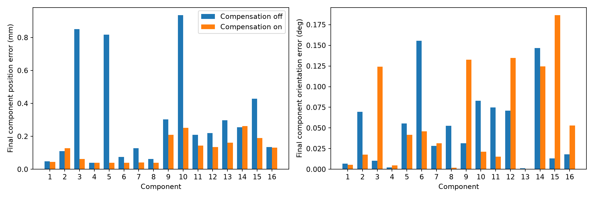
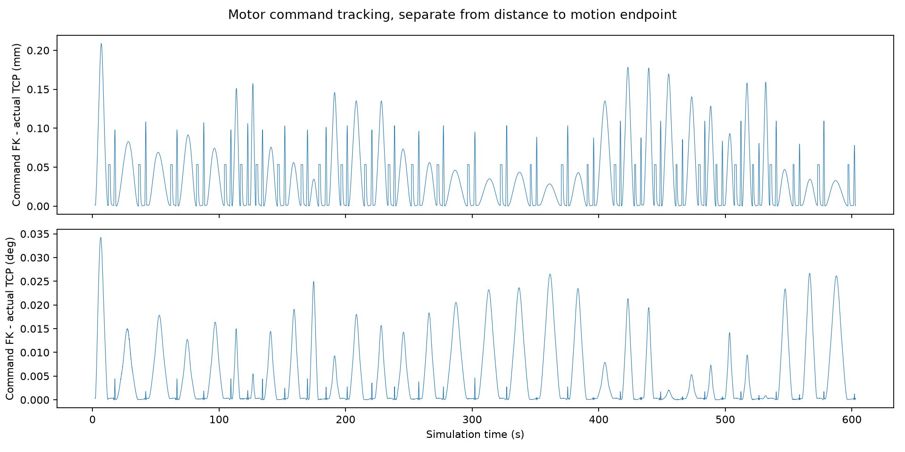
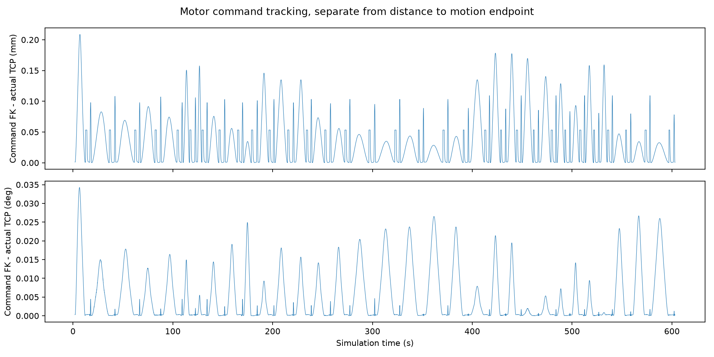
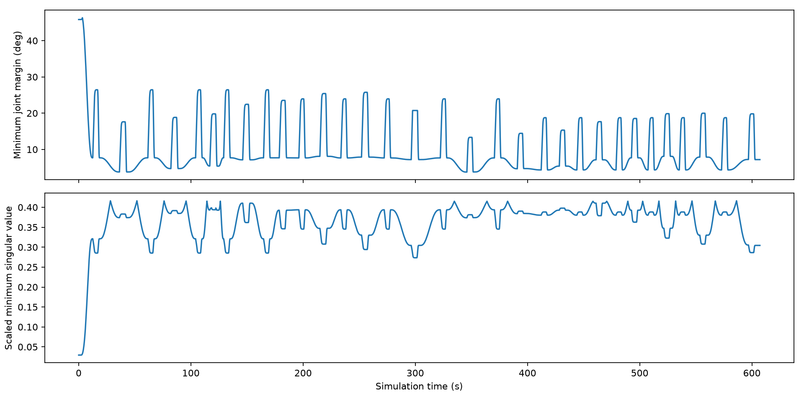
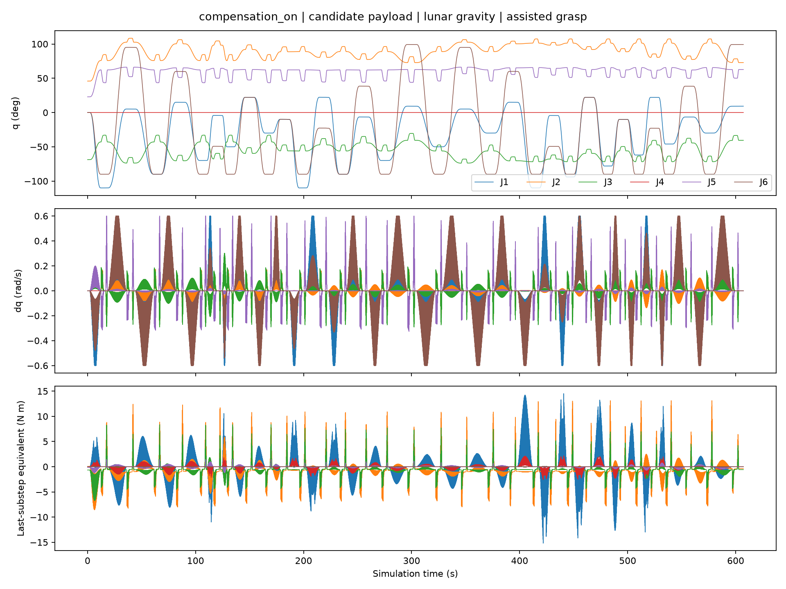
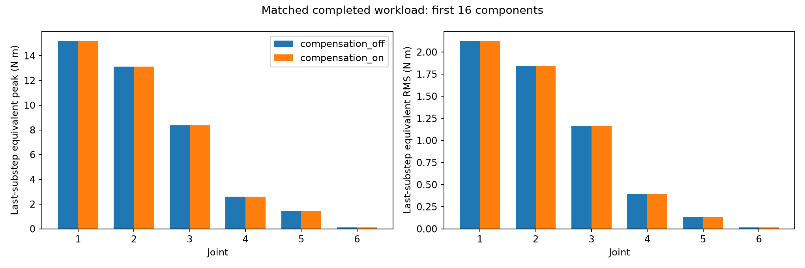

# PiPER运动学控制与月面装配评价

编写日期：2026年11月10日。本文为B技术章节，可并入A维护的总报告。方法和参数按冻结源码核对，同环境补偿关闭／开启两组从零16件正式结果与独立复核已接入。两组均完整成功；第8节据真实数据讨论位置收益、姿态及部分力矩代价。本稿技术内容已完成；实际提交及推送状态见根[CHANGELOG](../../CHANGELOG.md)，材料正式采用仍待A本人签核。

本研究使用固定基座PiPER六轴机械臂与双指夹爪，在月面重力数值环境中装配两层16件槽榫构件。B负责从URDF构建运动学、求解抓放姿态、闭环控制与精度／关节力矩评价；C提供场景、避碰规划和装配流程，A提供几何及候选惯性参数。第三阶段以同一环境、同一代码的抓取偏置补偿开关对照，检验装配误差、可行性和驱动力矩的变化。结论限定于候选刚体材料、辅助约束抓持、理想仿真状态和离散碰撞检查。

## 1 坐标和符号

世界系记为W，机器人根坐标系为B，夹爪基座为G，名义工具中心为T，构件底面几何系为O，构件质心惯性系为C。齐次变换上标表示表达坐标系，下标表示被描述坐标系。控制和日志内部采用m、rad、s；报告展示长度误差用mm、姿态误差用°，均先在原始单位计算后换算。四元数存储顺序为x、y、z、w。

| 符号 | 含义 | 单位／约定 |
|---|---|---|
| q、dq | 六轴关节角与角速度 | rad、rad/s，按joint1至joint6名称映射 |
| w | 双指名义开口 | m，joint7=w/2、joint8=−w/2 |
| p_T、R_T | TCP世界位置与旋转矩阵 | m、SO(3) |
| r_GT | gripper_base到名义TCP的偏移 | [0,0,0.1358]m |
| r_OC | 底面几何原点到质心的偏移 | 沿构件几何轴表达，m |
| J | TCP世界系几何雅可比 | 6×6，排列为[线速度；角速度] |
| L、W_s | 特征长度与任务缩放矩阵 | L=0.3m，W_s=diag(1/L,1/L,1/L,1,1,1) |
| Δt_p、Δt_c | 外部物理步与控制周期 | 1/240s、4/240s |
| u_j、τ_j* | 原始电机反馈、最后子步等效力矩 | 原始字段与经本机校准换算值分别保存 |

名义TCP由模型约定，不是厂家标定接触中心。双指直线关节不改变该名义TCP，因此不混入六轴任务雅可比。构件原点为底面中心，X沿长边、Y沿宽边、Z向上；它与Bullet返回的刚体质心原点不同。[M1、M2、M5]

## 2 运动学与逆解

### 2.1 URDF正运动学

沿URDF从根连杆至gripper_base的有向关节链，依次累乘固定原点变换与关节运动变换；固定关节保留其固定变换，六个转动关节使用各自局部轴和角度。最后乘TCP平移偏置。可写为：

    T_WT(q) = T_WB × ∏[F_k M_k(q)] × Trans(r_GT)              (B1)

其中F_k来自URDF的xyz、rpy；转动关节M_k为绕局部单位轴的旋转，固定关节M_k为单位矩阵。程序从模型树读取变换，不用讲义示例连杆尺寸代替PiPER参数。

实际TCP通过Bullet连杆质心位姿与局部惯性变换反求URDF连杆位姿，再施加r_GT：

    T_WG = T_WC,G × inverse(T_GC,G)
    p_T = p_G + R_G r_GT                                      (B2)

这样与解析FK比较的是同一名义点，也避免将质心位置误当工具点。[M1至M3]

### 2.2 几何雅可比和数值核对

设第i转轴在世界系中的单位方向为a_i，轴原点为o_i，则：

    J_i(q) = [ a_i × (p_T − o_i) ; a_i ]
    [v_T ; ω_T] = J(q) dq                                    (B3)

后三行描述角速度，不是欧拉角导数。位置和姿态残差分别定义为：

    e_p = p_d − p_T
    e_R = vee(Log(R_d R_Tᵀ))                                 (B4)

姿态误差幅值为最短轴角，避免直接相减欧拉角和四元数正负号造成歧义。解析J的核对包括URDF FK对Bullet实际TCP、基座旋转后的Bullet雅可比、中心差分和瞬时速度。历史60配置检查只作方法已有证据；本轮分析另取每组72个执行状态作差分，独立验收另取每组60个状态；两者与历史检查分别保存，第8.7节给出实际误差。[M2、M4]

本轮执行状态的中心差分方法沿用h=10⁻⁶rad：平移列用[p(q+h e_i)−p(q−h e_i)]/(2h)，旋转列用vee(Log(R(q+h e_i)R(q−h e_i)ᵀ))/(2h)。雅可比核对是模型／实现一致性检查，不是装配动态或避碰证明。

### 2.3 加权阻尼逆运动学

平移和旋转量纲不同，采用A=W_s J、b=W_s e，在每次迭代求：

    δq = Aᵀ(AAᵀ + λ² I)⁻¹ b                                (B5)

逆解迭代λ=0.015，单次δq按最大绝对分量缩放至0.15rad，再用1、0.5、0.25、0.1回溯步长搜索。这里的迭代增量不是实际电机角速度。候选关节角投影到URDF限位内缩2°的区间，多初值分别尝试，每个初值最多250次迭代。只接受独立FK残差满足位置<10⁻⁵m、姿态<10⁻⁴rad的解，失败则报错，不能将截断后的关节角直接标为成功。[M2]

正式报告应分别列名义抓放目标和补偿后的实际指令目标。未补偿96个名义目标可达，不自动证明偏移后目标或两点间路径可行。本轮实际目标评价应读取各段planning_log中的target、goal_q与执行状态，而非重新生成旧名义表后称其为已执行目标。

## 3 闭环控制与装配协调

### 3.1 关节过渡和笛卡尔反馈

六轴使用Bullet POSITION_CONTROL内环，positionGain=0.15、velocityGain=1.0，配置force来自URDF的100。电机maxVelocity设置为min(0.6,URDF上限)rad/s；这与外环DLS的0.35rad/s缩放值、五次曲线名义速度是不同层级的设置，均不能直接称为厂家额定安全上限。[M1]

非竖直运动先在关节空间求路线，每条路线边采用：

    q_cmd(t) = q_a + h(s)(q_b−q_a),  s=t/T
    h(s)=10s³−15s⁴+6s⁵                                      (B6)

端点的一、二阶导数为零。对当前非竖直边，T不小于1s，且满足代码中的1.875 max|Δq|/0.35与sqrt(5.8 max|Δq|/0.6)时长下界，再向上取整到控制周期。该曲线构造说明名义命令的平滑性；实际运动仍受伺服、接触、路径节点和后续反馈影响，需用执行关节日志核对。

外环任务速度取[v；ω]=[3e_p；3e_R]，分别将范数限制为0.04m/s、0.3rad/s；用式(B5)的速度形式、λ=0.02求dq，并统一缩放使各分量最大绝对值不超过0.35rad/s。积分参考量按Δt_c更新，同时施加关节限位和实际q±0.03rad的参考偏离约束。保留积分参考可提供抵抗重力所需的位置偏置；本方法不是显式逆动力学前馈或直接力矩控制。[M2、M3]

descend和lower先按不大于2mm的笛卡尔位置间隔求一列IK解，并按0.001rad关节边分辨率预检，再用带几何守卫的DLS闭环逼近该段终点。执行控制周期60Hz，实际物理按240Hz外部步推进，每外部步4内部子步，即1/960s内部步长。[M6、M7]

每个运动目标需连续15个60Hz控制样本满足TCP位置误差<0.1mm、姿态误差<0.1°、六轴最大实际角速度<0.02rad/s，才返回reached；反馈段最多20s。这些是组内数值收敛门槛，不是教师评分指标，也不是最终构件落位门槛。

### 3.2 采样规划与实际执行

C的规划先检查关节直连，受阻时才尝试RRT-Connect。非竖直段通常从0.005rad关节边分辨率开始，候选路径还需通过实际五次指令网格预检；预检失败可重试并加密。竖直段采用前述采样IK预检，各控制指令与采样实际状态均再检查。每段更新其余15件动态障碍，并在检查副本中放置持件及其他构件；副本允许重设，不能把检查副本的几何重设误称为实际模型瞬移。[M6至M9]

结果应按逐段planning_log区分直连、RRT绕行和竖直DLS；不能因工程包含RRT代码就称本轮发生RRT绕行。边分辨率和command_preflight字段也是逐段属性。主result中的exact_command_grid_preflight=false为现有旧汇总字段，不足以否定非竖直段已执行的命令网格检查；正式解释以源码及逐段记录为准，保留原始字段，不偷偷改写证据。

计划中带载构件对其他构件的距离下界为0，执行守卫保留0.2mm穿透容差；机器人与持件指定夹持区、地面支承和连杆相邻排除另有定义。物理观察器对机器人一般接触采用0.1mm穿透筛选，限定夹指／槽接触允许至0.5mm，构件间及当前件／地面采用0.2mm阈值。所有“定义外碰撞0”都应连同这些对象、阶段和阈值说明，不能解释为无任何接触或连续时间保证。[M5、M8]

### 3.3 夹取与释放

16件在开始物理步前全部预置，实际场景包含机器人、地面、料盘与16件，共19物体。每件依次执行接近、下降、闭爪、抬升、转运、下放、释放、退回和沉降；完整运行应有96个运动目标。[M5]

闭爪命令为joint7=+0.011m、joint8=−0.011m，每指force参数为1。等待1s后，要求两侧夹指在槽部区域存在正法向力接触，才以当时实际相对位姿建立固定辅助约束，约束maxForce参数为30。源码未在该操作中重设实际构件位置；本轮仍需用attach事件及位姿记录核对无建立瞬移。

释放时先命令36mm开口，每指force参数1，必要时升至3，每级最多3s；每50ms检查一次，连续5个样本同时满足以下条件才解除辅助约束：开口>35.5mm、没有法向力>10⁻⁴N的有效手指接触、构件线速度<2mm/s、角速度<0.02rad/s。此处“无有效接触”不是接触列表长度为零，也不是连续监测250ms的证明。解除后构件继续物理沉降。[M5、M10]

固定约束可传递力与力矩，帮助保持构件相对姿态；被夹件的质量、惯量和重力仍参与物理系统，但其载荷分配不由纯摩擦接触单独决定。因此关节反馈反映“机器人＋辅助约束持件”系统，不能据此估计纯摩擦抓取裕度、真实夹紧力、滑移可靠性或实物抓取成功率。约束原始六维反馈也不能不经坐标／力矩参考点变换就与TCP力旋量或关节电机力矩相加。

## 4 候选材料与惯性坐标

A于11月9日明确保留材料为候选，正式采用待本人签核。本轮使用既有A-candidate输入开展条件性的数值评价，不代A确认材料，不把CAD实体核对等同于强度或月面制造验证。[M11、M12]

| 输入 | 冻结候选值 |
|---|---|
| 构件 | P3-GrooveKey-v2，34凸碰撞子形状 |
| 密度 | 2500kg/m³，均匀刚体近似 |
| CAD体积 | 2.9042666666666666×10⁻⁵m³ |
| 单件质量 | 0.07260666666666667kg |
| r_OC | [0,0,0.010566253098888994]m |
| 关于COM、沿几何轴的惯量 | diag(7.554717961655561×10⁻⁶,1.8706254628322218×10⁻⁵,2.0403439999999998×10⁻⁵)kg·m² |
| 重力 | [0,0,−1.62]m/s² |
| 构件／地面侧向摩擦参数 | 0.6；构件恢复系数0，碰撞margin参数0.00005m |

惯量已经关于质心，不能直接作为关于底面原点的惯量使用，也不应为导入质心惯性系而再做一次平行轴平移。当前惯性轴与几何轴一致，源码检查惯量张量对角、正定，并使用URDF_USE_INERTIA_FROM_FILE加载。运行中的loaded_payload.json应与候选JSON逐项核对质量、惯量、惯性原点及姿态。[M5]

Bullet给出的刚体基座位姿在此模型中对应惯性系。恢复构件底面几何原点：

    p_O = p_C − R_WO r_OC                                    (B7)

本例惯性旋转为单位矩阵，R_WC=R_WO；以后若改变主轴或导入非对角张量，应先重新建立惯性系变换，不能套用本例简化式。构件落位误差、槽部接触判断、抬升后抓取偏置推算均必须采用一致的几何／惯性原点约定。

### 4.1 机器人实际导入惯量的边界

构件与机器人使用不同加载设置：构件显式设置URDF_USE_INERTIA_FROM_FILE并逐项核对候选COM惯量；原PiPER加载器使用自碰撞flag，没有设置该惯量保留标志。因此“原URDF文件未修改”不等于机器人实际导入惯量逐字保留原张量，更不等于厂家标定动力学。[实际导入记录](../运行验证/B_第三阶段_2026-11-10/robot_loaded_dynamics.json)逐杆列出质量、COM、惯性姿态、实际主惯量及原URDF声明。[M21]

例如link2实际导入对角惯量为约[0.00205935,0.01325068,0.01324127]kg·m²，与文件声明的对角项[0.00116918,0.06785384,0.06774489]并不相同。本轮保持既有导入方式，未中途切换标志；两工况比较具有相同机器人模型条件，但绝对驱动力矩属于这一Bullet导入模型。若以后要求严格采用另行认可的机器人惯量，应冻结新模型并重新成对运行，不能只改报告文字就沿用本次绝对力矩。

## 5 理想仿真位姿抓取偏置补偿

补偿在每件抬升到TCP高82mm之后计算。读取实际TCP变换及恢复后的构件几何原点，求几何原点在当前TCP系中的偏移，再按目标工具朝向预测该偏移的世界水平分量：

    r_TO = R_WTᵀ(p_O − p_T)
    R_WT,d = R_z(ψ) diag(−1,1,−1)
    δp_xy = −[R_WT,d r_TO]_xy
    p_T,cmd,xy = p_O,target,xy + δp_xy                        (B8)

只修正transfer和lower的TCP水平指令；构件名义目标、碰撞判据及物理参数不变。δp_xy范数超过0.002m时源码直接抛错，不做2mm截断继续运行。退回仍使用名义目标XY；该命令区别应在轨迹解释中保留。[M5]

此算法依据精确仿真状态，没有视觉、标定误差、姿态估计噪声或通信时延模型，也没有用式(B8)补偿构件姿态误差。它用于研究夹取后偏置对小间隙放置的影响，不构成真实视觉闭环或感知鲁棒性验证。

## 6 采集与三类评价

### 6.1 日志和时间基准

Telemetry在每个240Hz外部物理步后保存六轴q、dq、motor原始反馈，夹爪位置／速度／电机力，八个关节传感器六维反力及辅助约束六维原始反馈，并记录步号、时间、件号、阶段和attached状态。等待、闭爪、释放和沉降同样采集；故完整关节日志不是只截取运动段。每行应满足time_s=step/240，步号从1连续，行数与result中的telemetry_rows及仿真时长相符。[M5、M13]

TCP控制日志b_control_trace约为60Hz，只在控制记录时生成，包含相对该运动终点的目标／实际位姿。trajectory约20Hz，库存约2Hz，视频约5fps；这些不能冒充240Hz或960Hz全状态记录。跨日志对齐应以时间、件号和planning_log为依据；b_control_trace的phase是控制策略，Telemetry的phase是装配动作，两者同名字段的语义不同。

### 6.2 位姿精度

每个已完成运动段报告其最后收敛TCP误差及必要稳态统计：位置范数为1000‖p_d−p_T‖mm，姿态为(180/π)‖vee(Log(R_dR_Tᵀ))‖°。原控制日志中的目标位姿是该段终点，整个搬运过程的终点相对误差包含正常运动和目标切换；其过程最大值或全段RMS不能直接称为命令跟随误差或最终装配精度。[M3、M14]

控制日志同时保存六轴电机位置参考q_command，可用同一URDF运动学将其转换为名义TCP参考，与该控制记录的实际TCP比较，定义命令跟随误差：

    T_cmd(k) = FK(q_command(k))
    e_cmd,p(k) = 1000‖p_cmd(k) − p_T(k)‖                     (B9a)
    e_cmd,R(k) = (180/π)‖vee(Log(R_cmd(k)R_T(k)ᵀ))‖
    e_q,j(k) = q_j,actual(k) − q_j,command(k)                 (B9b)

分别报告TCP位置／姿态命令跟随误差的峰值与RMS，以及每关节命令误差的绝对峰值与RMS。位置RMS为sqrt[Σe_cmd,p(k)²/N_c]，姿态同理；关节误差先按rad计算，再按180/π换算为°。N_c为实际控制记录数，不是240Hz全程采样数。本轮按上述定义统计命令跟随指标，结果见第8.3节。[M17]

记录在施加该位置参考并推进一个控制周期后生成，因此比较的是该周期使用的电机参考与周期末实际状态。此指标可评价内环及机械系统对已发出位置参考的跟随；它不是相对另行给定的理想笛卡尔时间轨迹的误差，也不是构件落位误差。五次关节过渡和DLS积分均会生成随时间变化的q_command，其中DLS参考可保留抗重力偏置，故命令跟随误差、终点收敛误差和最终构件误差可能呈现不同变化。采样间隔内的偏差、延迟模型及真实传感误差不由该60Hz指标证明。

构件最终误差应在全流程结束并最终沉降后，由式(B7)计算底面原点与名义目标的差；姿态为目标构件旋转与实际旋转间的最短角度。报告逐件、全体最大值，位置和角度分别统计。原流程最终成功还要求每件位置<3mm、姿态<0.05rad、线速度<5mm/s且有下方支承接触，另要求无定义外碰撞且计划构件全部完成。这组内部装配判据与0.1mm／0.1°的TCP收敛判据不同。[M5]

若流程失败、final为空或为对象而非列表，最终16件误差不可用，填写“未形成完整最终状态”；可另报失败前item_results或快照，但必须注明采样时刻和是否仍持件，不以0填充未测值。

### 6.3 关节与轨迹可行性

对240Hz全程实际样本计算每关节限位裕度：

    m_j(k) = min(q_j(k)−q_j,min, q_j,max−q_j(k))              (B10)

按关节及全程报告最小值，同时统计实际角速度；URDF速度上限、0.6rad/s电机命令上限、0.35rad/s外环缩放和实际测值分开列出。正限位裕度不代表远离奇异性。

对A(q)=W_sJ(q)作SVD，报告全程最小σ_min、最大条件数κ=σ_max/σ_min，以及目标点与路径最差状态。秩判定沿用源码数值阈值10⁻⁸，接近零时条件数按不可定义处理；没有另造通用安全阈值。目标可达、路径采样通过、闭环到达和最终构件成功是四层不同结果，需分别计数。[M2、M14]

轨迹评价还需报告各规划方法的实际使用次数、命令预检通过数、执行失败阶段、碰撞事件及阈值、96目标的完成数、场景19物体是否恒定、各次释放是否通过。采样和物理步观察均通过仍不构成连续避碰或结构稳定性证明。

### 6.4 月面重力下基本关节力矩

力矩来自POSITION_CONTROL模式下getJointStates的电机反馈字段，不是逆动力学计算或硬件测力。传感器反力与固定约束反馈分别保存，不与motor相加。校准用已知0.162N·m静态重力矩，以及无重力单转动／直线关节的已知惯量／质量饱和加速度对照，分别检查1和4内部子步。[M13、M15]

当前本机构建的校准支持：

    τ_j*(k) = n_s u_j(k),  n_s=4
    peak_j = max_k |τ_j*(k)|
    RMS_j = sqrt[ Σ_k τ_j*(k)² / N ]                         (B11)

它表示外部步采到的“最后内部子步等效力矩”。240Hz采样只保留960Hz内部更新的一部分信息，不是每个内部子步的峰值，也不是该外部步全部子步的平均。校准必须与正式环境、构建和子步配置一致；新环境校准不通过时停止套用乘4结果。

六轴表同时列原始峰值、等效峰值、等效RMS、峰值时间／件号／阶段。分阶段表覆盖运动与等待。100是六轴API force配置；400仅是当前校准解释下的数值等效限幅参考，不是测得的硬件额定力矩。闭爪1、开爪1／3同样是API参数，不能直接当实际接触压力。

总电机反馈含机器人自重、构件重力和惯性、内环调节与接触／约束作用，不是仅由72.6g构件造成的增量力矩。峰值低于模型配置不代表实机驱动安全、热稳定或耐久；没有实机电机模型和额定值时不作此类结论。

## 7 同环境正式实验方案

两工况均从零请求16件，分别关闭／开启抓取偏置补偿，其余条件保持相同。两次实验串行运行，分别保存独立结果，避免同时改写共享构件网格缓存；分析读取冻结源码和各次原始记录。成功或失败均保留，不使用检查点拼接替代从零运行。

冻结项目包括PiPER URDF和网格、槽榫几何与34分块、16件初始与名义目标、候选载荷、重力、时间步／子步、solver迭代数、控制与规划参数、接触缓存参数、碰撞阈值和释放门控。补偿开启仅增加式(B8)的处理；若发现必须修控制代码或参数，先留存旧证据，再建立新的成对冻结版本，不能将不同修订拼成单因素对照。

审阅起点为已发布整合提交dbcc96698dbe876792955e3e2db65d8289cf9bbb。正式运行时以实际冻结清单、各次run_manifest、参数及源码哈希为准；不能只凭起始Git号推定运行中未改文件。

每工况至少提供环境与依赖记录、精确命令、源码／参数哈希、loaded_payload、result、完整240Hz日志、TCP控制日志、场景／释放记录和对应视频。本轮清单和路径均已封存于运行验证/B_第三阶段_2026-11-10，分析／比较入口在B_第三阶段正式评价；实际版本及核对结果见第8.1、8.7节。

若一工况提前失败，先比较两者共同完成的构件、动作和阶段。设K为两工况均完成的完整构件前缀，选择相同件号≤K和相同阶段集合，对各自原始样本分别统计峰值／RMS，同时给出样本数和持续时间。全流程统计另列；不能把失败工况较短的RMS与成功工况较长的RMS直接解释为相同工作量下优劣。若需要比较部分第K+1件，单独明确共同动作终点，不混入共同完整构件集合。

若两者都16/16，按实际误差和代价比较，不编造“修复前失败”；若两者均失败，须说明冻结工况仍不足以满足阶段要求。每工况单次运行只能支持该次条件性对照，不提供成功概率、统计显著性或鲁棒性结论。历史B本机无补偿和C Windows补偿结果的方法与平台均不同，只作背景，不能替代本轮同环境对照。

## 8 正式结果与讨论

2026年11月10日，两工况均在冻结环境中单次从零完成16件，均未恢复检查点。关闭补偿没有发生本轮装配失败；开启补偿的位置误差较小，但姿态和部分关节力矩代价增加。所有数值来自本轮[成对结果摘要](../B_第三阶段正式评价/第三阶段结果摘要.json)、对应原始记录及[独立验收结果](../运行验证/B_第三阶段复核_2026-11-10/独立验收结果.json)。历史B／C运行仅用于边界讨论。[M18至M24]

### 8.1 冻结环境与完整运行

两组依次于香港时间15:46:17—15:58:35、15:58:35—16:10:56执行。平台macOS26.1／arm64，Python3.12.14、PyBullet3.2.7、NumPy2.5.4、SciPy1.18.1。25项运行源码和69项资源冻结，运行后核对未变；初始库存与首次补偿前的原始采样SHA相同。唯一算法开关为补偿启用与否，输出目录和执行时间另行记录。[实验清单](../运行验证/B_第三阶段_2026-11-10/experiment_manifest.json)保存逐次命令，[环境指纹](../运行验证/B_第三阶段_2026-11-10/environment_binary_fingerprint.json)保存依赖和PyBullet二进制SHA；不能把起始Git号等同于全部未提交评价脚本也已发布。

| 表B1 运行指标 | 关闭补偿 | 开启补偿 |
|---|---|---|
| 从零完成／退出码 | 16/16；0 | 16/16；0 |
| 到达运动目标 | 96/96 | 96/96 |
| 释放门控／无瞬移附着 | 16/16；16/16 | 16/16；16/16 |
| 释放升至3参数的件数 | 0 | 0 |
| 场景物体数 | 19恒定 | 19恒定 |
| 240Hz全程行数 | 145676 | 145712 |
| 60Hz控制记录数 | 32462 | 32465 |
| 仿真时长 s | 606.9833 | 607.1333 |
| 墙钟时长 s | 737.087 | 740.722 |
| 原速视频帧数／5fps | 3035 | 3036 |

两组均覆盖初始化、接近、下降、闭爪、抬升、转运、下放、释放、退回、等待及最终沉降11类阶段。开启组较关闭组增加36个外部样本，即0.15s；墙钟增加3.634s，受计算调度、录像与写盘影响，不作算法速度显著性结论。两次视频为同次物理渲染，关闭3035帧、开启3036帧；帧数除以5得到的607.0／607.2s是离散录像长度，不与物理末时刻强行等同。[关闭原速视频](../运行验证/B_第三阶段_2026-11-10/compensation_off/assembly.mp4)／[开启原速视频](../运行验证/B_第三阶段_2026-11-10/compensation_on/assembly.mp4)。

### 8.2 构件最终落位

| 表B2 最终落位指标 | 关闭 | 开启 | 开启−关闭 | 相对变化 % |
|---|---|---|---|---|
| 最大位置误差 mm | 0.935791 | 0.261732 | -0.674059 | -72.031 |
| 跨16件位置RMS mm | 0.422179 | 0.142215 | -0.279964 | -66.314 |
| 最大姿态误差 ° | 0.155598 | 0.186519 | 0.030921 | 19.872 |
| 跨16件姿态RMS ° | 0.069075 | 0.082937 | 0.013862 | 20.068 |

最终位置／姿态RMS是跨16个构件的RMS，不是时间RMS。逐件结果见表B3和[原始比较CSV](../运行验证/B_第三阶段_2026-11-10/final_component_comparison.csv)，均相对未改变的名义构件目标，非补偿后的TCP目标。

| 表B3 件号 | 关闭位置 mm | 开启位置 mm | 关闭姿态 ° | 开启姿态 ° |
|---|---|---|---|---|
| 1 | 0.048508 | 0.044299 | 0.006837 | 0.005265 |
| 2 | 0.110890 | 0.127255 | 0.069526 | 0.017573 |
| 3 | 0.851417 | 0.062576 | 0.010377 | 0.124046 |
| 4 | 0.040077 | 0.040062 | 0.002177 | 0.004681 |
| 5 | 0.818079 | 0.039962 | 0.055542 | 0.041560 |
| 6 | 0.074782 | 0.040189 | 0.155598 | 0.045782 |
| 7 | 0.127031 | 0.041195 | 0.028444 | 0.031608 |
| 8 | 0.062999 | 0.039979 | 0.052778 | 0.001726 |
| 9 | 0.303286 | 0.208822 | 0.031374 | 0.132532 |
| 10 | 0.935791 | 0.251215 | 0.082859 | 0.021279 |
| 11 | 0.210010 | 0.143901 | 0.074719 | 0.015358 |
| 12 | 0.219985 | 0.135371 | 0.070983 | 0.134538 |
| 13 | 0.297467 | 0.161203 | 0.001222 | 0.000425 |
| 14 | 0.255107 | 0.261732 | 0.146585 | 0.124616 |
| 15 | 0.428566 | 0.189165 | 0.013066 | 0.186519 |
| 16 | 0.134977 | 0.131894 | 0.018105 | 0.053041 |

图B1　同环境16件最终误差。蓝色关闭、橙色开启；位置与姿态分别统计。

开启后最大位置误差由0.935791降至0.261732mm，降低72.031%；位置RMS降低66.314%。14件位置误差减小，件2和14略增，不能说每件都改善。关闭组位置最差在件10，开启组在件14；姿态最差由关闭组件6的0.155598°变为开启组件15的0.186519°，增加19.872%。因此位置收益不等于姿态收益。两组最终线速度与下方接触记录也满足原成功判据，但这不是结构强度或整体稳定性认证。

### 8.3 TCP收敛与电机位置参考跟随

| 表B4 控制精度指标 | 关闭 | 开启 |
|---|---|---|
| 段末TCP最大位置误差 mm | 0.047565185 | 0.047560482 |
| 段末TCP最大姿态误差 ° | 0.000350049 | 0.000350049 |
| 命令FK位置RMS mm | 0.057411871 | 0.057414644 |
| 命令FK位置峰值 mm | 0.208731938 | 0.208731938 |
| 命令FK姿态RMS ° | 0.009192458 | 0.009191051 |
| 命令FK姿态峰值 ° | 0.034269939 | 0.034269939 |

两组段末TCP位置最大值均约0.04756mm，命令FK位置RMS均约0.05741mm，变化远小于构件落位位置的变化。说明本例补偿主要改变持件放置的几何对准，而非显著改善电机参考跟随；不能将构件位置改进等同于内环精度改进。每关节命令误差见表B5及各组joint_command_tracking.csv。

| 表B5 关节命令误差 | 关闭RMS ° | 开启RMS ° | 关闭绝对峰值 ° | 开启绝对峰值 ° |
|---|---|---|---|---|
| J1 | 0.010188139 | 0.010189087 | 0.031661164 | 0.031661164 |
| J2 | 0.003366569 | 0.003366542 | 0.013210027 | 0.013210027 |
| J3 | 0.004053896 | 0.004051671 | 0.014518479 | 0.014518472 |
| J4 | 0.000055547 | 0.000055241 | 0.000155457 | 0.000147115 |
| J5 | 0.006213684 | 0.006214247 | 0.030923242 | 0.030923656 |
| J6 | 0.014530363 | 0.014524492 | 0.031786648 | 0.031791673 |

图B2a　关闭补偿，FK(q_command)到实测TCP的误差。

图B2b　开启补偿，采用相同定义和采样方式。

原日志到每段固定终点的全过程位置RMS为194.888／194.916mm，含正常大范围搬运和目标切换，不是命令跟随误差，更不是约0.2m的装配落位误差。[关闭终点相对误差曲线](../运行验证/B_第三阶段_2026-11-10/compensation_off/TCP_target_tracking.png)与[开启曲线](../运行验证/B_第三阶段_2026-11-10/compensation_on/TCP_target_tracking.png)保留作过程解释，不与图B2混用。

### 8.4 目标可达性 关节约束与奇异性

| 表B6 运动学指标 | 关闭 | 开启 |
|---|---|---|
| 实际已解／已执行目标数 | 96 | 96 |
| 实际目标最小限位裕度 ° | 3.778358080 | 3.753454177 |
| 实际目标最小缩放σ | 0.273453728 | 0.273436755 |
| 实际目标最大条件数 | 8.719633059 | 8.720142198 |
| 全程最小限位裕度 ° | 3.777857268 | 3.753456447 |
| 全程最小缩放σ | 0.029388329 | 0.029388329 |
| 不含initialize的最小缩放σ | 0.029388804 | 0.029388804 |
| 全程最大缩放条件数 | 94.087202419 | 94.087202419 |
| 六轴实际最大角速度 rad/s | 0.600575621 | 0.600470461 |
| URDF速度超限样本数 | 0 | 0 |

名义96目标均通过IK，名义最小裕度3.778358°、最小缩放σ=0.273454；实际指令另逐段复算，两组均96目标，已包含开启工况修正后的transfer／lower目标。实际目标FK最大位置残差分别9.868991×10⁻⁶／9.868834×10⁻⁶m，最大姿态残差均1.969851×10⁻⁵rad，满足逆解接受设置。

所有240Hz状态按L=0.3m计算的J均为数值rank6；最小σ=0.029388329发生在首个initialize样本（t=1/240s），不是某一抓放目标。去掉initialize后最小值仍约0.029388804。关闭组最小限位裕度发生在件10的approach、J5、t=352.883333s；开启组在件9的transfer、J5、t=345.979167s，裕度由3.777857略减至3.753456°。没有以任意“通用奇异性阈值”宣称安全。

| 表B7 逐轴实际状态 | 关闭最小裕度 ° | 开启最小裕度 ° | 关闭最大速度 rad/s | 开启最大速度 rad/s |
|---|---|---|---|---|
| J1 | 40.000423 | 40.000423 | 0.600060391 | 0.600049938 |
| J2 | 45.836639 | 45.836639 | 0.273946728 | 0.273946722 |
| J3 | 30.509650 | 30.506220 | 0.301797012 | 0.301796880 |
| J4 | 99.980395 | 99.980411 | 0.000477144 | 0.000477144 |
| J5 | 3.777857 | 3.753456 | 0.600009000 | 0.600006198 |
| J6 | 20.740370 | 20.738477 | 0.600575621 | 0.600470461 |

J1、J5、J6的实际速度可轻微超过0.6rad/s命令设置，不能把电机参数当作实际速度的严格不超调保证；两组均未超过模型URDF的[5,5,5,5,5,3]rad/s速度上限。URDF限制也不是本项目已验证的硬件额定值。

图B3a　关闭补偿的全程限位裕度和缩放最小奇异值。

图B3b　开启补偿，尺度与图B3a一致；统计取全体样本，图形仅作显示。

### 8.5 路径执行 碰撞与释放

| 表B8 执行检查 | 关闭 | 开启 |
|---|---|---|
| 非竖直指令网格预检通过段 | 64 | 64 |
| 竖直采样IK／在线守卫段 | 32 | 32 |
| RRT尝试／实际执行段 | 0／0 | 0／0 |
| 失败规划段 | 0 | 0 |
| 定义外执行碰撞 | 0 | 0 |
| 16次释放稳定门控 | 全部通过 | 全部通过 |
| release参数升至3 | 未发生 | 未发生 |
| 已装构件与其余障碍纳入快照 | 每段15障碍，共96快照 | 每段15障碍，共96快照 |

两组均采用64段已检查直连与32段竖直方法，不能称为本轮验证了实际RRT绕障。非竖直实际边分辨率0.005rad，竖直0.001rad并按2mm位置采样；逐段记录说明预检和在线保护，旧汇总布尔字段仍原样保留。执行碰撞计数0只表示没有触发第3.2节定义外条件，不证明所有接触消失、始终存在正安全间隙或连续轨迹完全无碰撞。全程最小几何间隙没有记录，因此不提供虚构的间隙裕度。

开启组16件均记录了补偿事件，最大水平修正0.825833mm，低于2mm报错上限；没有改名义装配目标或直接重设构件。精确逐件修正见[compensation_offsets.csv](../运行验证/B_第三阶段_2026-11-10/compensation_on/compensation_offsets.csv)。两组附着瞬移均为0，释放均在force参数1阶段完成，无须升级3。

### 8.6 六轴力矩与共同任务比较

以下统计来自本轮6组反馈校准通过后的原始采样；原始字段与4倍最后子步等效值分开，所有力矩单位N·m。完整CSV分别为[关闭](../运行验证/B_第三阶段_2026-11-10/compensation_off/torque_full_run.csv)和[开启](../运行验证/B_第三阶段_2026-11-10/compensation_on/torque_full_run.csv)。

| 表B9 原始电机反馈 | 关闭绝对峰值 | 开启绝对峰值 | 关闭RMS | 开启RMS |
|---|---|---|---|---|
| J1 | 3.799378331 | 3.799090897 | 0.531516939 | 0.531515484 |
| J2 | 3.283108447 | 3.283352642 | 0.460045184 | 0.460105566 |
| J3 | 2.094413324 | 2.094742025 | 0.291885753 | 0.291847817 |
| J4 | 0.646728082 | 0.646545914 | 0.097844544 | 0.097848766 |
| J5 | 0.365542932 | 0.365550863 | 0.033391241 | 0.033368972 |
| J6 | 0.025056073 | 0.025056073 | 0.004380867 | 0.004480345 |

| 表B10 最后子步等效力矩 | 关闭绝对峰值 | 开启绝对峰值 | 关闭RMS | 开启RMS |
|---|---|---|---|---|
| J1 | 15.197513322 | 15.196363590 | 2.126067757 | 2.126061934 |
| J2 | 13.132433789 | 13.133410569 | 1.840180735 | 1.840422265 |
| J3 | 8.377653296 | 8.378968100 | 1.167543011 | 1.167391266 |
| J4 | 2.586912330 | 2.586183658 | 0.391378175 | 0.391395065 |
| J5 | 1.462171730 | 1.462203452 | 0.133564963 | 0.133475889 |
| J6 | 0.100224290 | 0.100224290 | 0.017523466 | 0.017921378 |

| 表B11 等效峰值位置 | 关闭：仿真s／件号／动作 | 开启：仿真s／件号／动作 |
|---|---|---|
| J1 | 421.704167／11／transfer | 421.804167／11／transfer |
| J2 | 540.204167／15／lift | 577.970833／16／lift |
| J3 | 169.804167／5／lift | 109.270833／3／lift |
| J4 | 421.704167／11／transfer | 421.804167／11／transfer |
| J5 | 169.737500／5／lift | 169.754167／5／lift |
| J6 | 472.537500／13／approach | 472.637500／13／approach |

最大六轴等效峰值均来自J1、件11转运，约15.2N·m。J2／J3峰值发生在抬升，J6在接近；它们包含机器人自重、伺服运动及接触／约束负载，不能按小构件质量直接归因。开启后J2、J3、J5峰值略增，J1、J4略减，J6峰值在报告精度下相同；J2、J4、J6全程RMS增加，其中J6由0.017523466增至0.017921378N·m，增幅2.271%，绝对增量0.000397912N·m。这些是本次确定样本的差异，不给统计显著性或实机热／能耗解释。

图B4a　关闭补偿的q、dq与最后子步等效力矩；展示与统计同一运行。

图B4b　开启补偿；不能将图中等效值当作960Hz全部内部峰值。

本轮两组均完成16件，故[共同任务CSV](../运行验证/B_第三阶段_2026-11-10/common_workload_torque.csv)与图B5比较的是各自完整16件任务，包含初始化和最终沉降，数值与表B10一致；它不是逐样本时长相同的配对序列。另由独立验收排除initialize及final_settle，比较共同16件的装配阶段（含闭爪、释放和等待），见表B12。样本分别144476／144512，持续601.983333／602.133333s。两种统计口径分别标注，不混称同一RMS。

| 表B12 不含初始化／最终沉降的等效RMS N·m | 关闭 | 开启 | 开启−关闭 |
|---|---|---|---|
| J1 | 2.134878928 | 2.134870891 | -0.000008037 |
| J2 | 1.847623017 | 1.847863722 | 0.000240705 |
| J3 | 1.171047850 | 1.170894432 | -0.000153418 |
| J4 | 0.393000156 | 0.393016712 | 0.000016556 |
| J5 | 0.133876287 | 0.133786604 | -0.000089683 |
| J6 | 0.017596089 | 0.017995632 | 0.000399543 |

图B5　两组完整16件任务的等效峰值／RMS，含初始化和最终沉降，来源为共同任务CSV；不是表B12的阶段掩码。

按动作细分及件号×动作细分结果保存在[关闭分阶段](../运行验证/B_第三阶段_2026-11-10/compensation_off/torque_by_phase.csv)、[开启分阶段](../运行验证/B_第三阶段_2026-11-10/compensation_on/torque_by_phase.csv)、[关闭件号×阶段](../运行验证/B_第三阶段_2026-11-10/compensation_off/torque_by_item_phase.csv)和[开启件号×阶段](../运行验证/B_第三阶段_2026-11-10/compensation_on/torque_by_item_phase.csv)。它们可解释峰值发生位置，不能单独证明补偿使所有动作更省力。

### 8.7 可追溯性与独立核对

| 表B13 实现／记录一致性 | 关闭 | 开启 |
|---|---|---|
| 全程连续240Hz记录 | 145676 | 145712 |
| 全部控制行FK位置最大差 m | 5.829e-16 | 5.609e-16 |
| 全部控制行FK姿态最大差 ° | 9.786e-14 | 9.196e-14 |
| 正式分析每组72状态差分J最大差 | 1.910e-10 | 2.070e-10 |
| 独立验收另取每组60状态差分J最大差 | 2.212e-10 | 1.720e-10 |
| TCP位置误差重新计算最大差 m | 0 | 0 |
| TCP姿态误差重新计算最大差 ° | 1.990e-13 | 1.990e-13 |
| 最终构件位置公式重新计算最大差 m | 0 | 0 |

72状态与另60状态是不同复核样本；每个240Hz状态均重新计算FK／J和缩放指标，不是每个状态都进行有限差分。极小FK／误差差值表示同一数值模型的实现一致性，不是实机达到10⁻¹⁶m精度。独立验收还核对实际96目标、六轴峰值／RMS、释放、视频帧数及同开关前原始日志一致。最后2Hz库存快照另作COM／姿态复原交叉检查，与精确最终时刻不同；它与最终位置误差的最大差为0.001992／0.000422mm，不能用较早快照覆盖最终记录。所有验收结果见[M20]，完整证据哈希见[M23]。

### 8.8 历史失败边界与方案选择

C于Windows的历史full01在第10件下放前受阻，只完成9件；随后补偿版成功。这是不同环境的历史故障，不是本轮关闭补偿结果。本轮关闭工况16/16成功，因此不能说补偿对当前冻结场景的完成是必要条件，也不能将成功率从9/16到16/16当作本次单因素改善。历史静态扫描两case还存在约21.609mm高度差，本轮不使用其−0.161／+0.224mm间距对比证明同高度纯XY因果效果。

**在本阶段定位优先的任务目标下，推荐开启抓取偏置补偿**：两组均完整成功，开启组降低最大和RMS位置误差，最大修正0.825833mm仍在既定2mm上限内；TCP终点及命令跟随保持近似水平。该选择接受最大姿态误差从0.155598增至0.186519°、姿态RMS增大、部分关节力矩增加和0.15s仿真时间代价，不宣称全面优于关闭方案。若后续装配更重视姿态、侧连接、感知噪声或驱动限制，应按新要求复验，不能直接沿用此定位优先推荐。每工况只有一次，未取得成功概率、统计显著性或鲁棒性结论。

## 9 局限与后续对接

候选密度及均匀刚体不等于实测材料，A的名义自重支承不等于整体抗倾覆、连接或强度验收。辅助固定约束不等于纯摩擦抓取，精确仿真位姿补偿不等于实际感知，离散检查不等于连续避碰。电机反馈的外步采样与子步换算不覆盖全部内部极值，模型参数不证明实机安全。以上局限在方法、表图标题和结论中保持一致。

本轮补偿只改变水平指令，未直接修正构件姿态或优化关节力矩；位置收益确实伴随姿态误差、部分关节峰值／RMS和执行时间增加，命令跟随没有相应明显改善。各指标按第8节分别报告，推荐仅针对当前定位优先任务。材料、机器人导入惯量、真实感知和抓取模型改变后均应重新评价。

A继续负责材料采用决定与结构解释；C负责正式工程、规划／视频及其感知／抓取假设；B对控制、坐标、精度与力矩解释负责。本轮B章节完成不表示全组材料已签核或课程全部交付已验收。给A和C的具体接入要求见[第三阶段对接说明](给A和C的第三阶段对接说明.md)。

## 10 方法来源

以下均为本地已读取的项目实现／记录。M18以后为本轮正式运行及独立验收来源；历史运行证据不代替本轮结果。本稿没有新增未经核实的外部文献或厂家参数，材料文献的选取及签核沿用A的候选说明。

| 编号 | 来源与核对位置 |
|---|---|
| M1 | [piper_robot.py](../B_关节与夹爪/piper_robot.py#L15)，TCP／关节映射、时间步；85—147行为加载和电机配置 |
| M2 | [kinematics.py](../B_基础控制与雅可比/kinematics.py#L39)，误差、FK/J、缩放、DLS与IK |
| M3 | [controller.py](../B_基础控制与雅可比/controller.py#L13)，实际TCP；114—174行为过渡、反馈与reached |
| M4 | [verify_kinematics.py](../B_基础控制与雅可比/verify_kinematics.py#L19)，两基座60配置、差分／速度／负向对照的历史验证方法 |
| M5 | [当前装配主程序](../C_仿真与装配/run_preloaded_tray_assembly_fast.py#L30)，加载、坐标、逐步观察、夹取／补偿／最终成功判据 |
| M6 | [preloaded_planning_fast.py](../C_仿真与装配/preloaded_planning_fast.py#L7)，竖直采样IK与DLS |
| M7 | [polygon_planning.py](../C_仿真与装配/polygon_planning.py#L21)，五次命令网格和闭环衔接 |
| M8 | [polygon_planning.py](../C_仿真与装配/polygon_planning.py#L7)及M5的167—204行，计划与执行距离阈值 |
| M9 | [motion_planning.py](../C_仿真与装配/motion_planning.py#L5)，直连优先与RRT-Connect |
| M10 | [gripper_release.py](../C_仿真与装配/gripper_release.py#L13)，分级开爪、有效接触和稳定门控 |
| M11 | [A材料假设确认](../../AC回传/A/材料假设确认.md)，11月9日仍候选、未本人签核 |
| M12 | [候选质量惯量JSON](../A_结构设计与CAD/04_构件参数与文献/质量惯量_候选参数.json)，完整精度与惯性坐标 |
| M13 | [telemetry.py](../B_第二阶段控制与评价/telemetry.py#L4)，每外部步motor／反力／约束分列 |
| M14 | [evaluate.py](../B_第二阶段控制与评价/evaluate.py#L34)，原二阶段分析定义及失败状态限制；本轮正式分析采用M17 |
| M15 | [verify_feedback.py](../B_第二阶段控制与评价/verify_feedback.py#L8)，6组原始反馈校准方法 |
| M16 | [第三阶段执行与验收计划](../../第三阶段_B执行与验收计划.md)，同环境对照、责任边界与本轮要求 |
| M17 | [第三阶段analyze_experiments.py](../B_第三阶段正式评价/analyze_experiments.py#L87)，q_command的FK参考、实际TCP差及逐关节命令误差；本轮最终实现与统计已按冻结记录核对 |
| M18 | [实验清单](../运行验证/B_第三阶段_2026-11-10/experiment_manifest.json)及[详细冻结配置](../运行验证/B_第三阶段_2026-11-10/control_and_model_freeze.json)，25源码／69资源、精确命令、起止时间和唯一开关 |
| M19 | [正式结果摘要](../B_第三阶段正式评价/第三阶段结果摘要.json)及[评价说明](../B_第三阶段正式评价/第三阶段评价说明.md)，本轮两组完整结果与比较 |
| M20 | [独立验收结果](../运行验证/B_第三阶段复核_2026-11-10/独立验收结果.json)，另60状态差分、实际96目标、全程峰值／RMS、视频和共同阶段统计 |
| M21 | [实际机器人动力学加载](../运行验证/B_第三阶段_2026-11-10/robot_loaded_dynamics.json)，不假定机器人URDF原惯量被完整保留 |
| M22 | [本轮反馈校准](../运行验证/B_第三阶段_2026-11-10/feedback_calibration.json)及[环境二进制指纹](../运行验证/B_第三阶段_2026-11-10/environment_binary_fingerprint.json)，6组通过与当前构建来源 |
| M23 | [证据SHA索引](../运行验证/B_第三阶段_2026-11-10/evidence_sha256.json)、[逐件比较](../运行验证/B_第三阶段_2026-11-10/final_component_comparison.csv)及[力矩权衡CSV](../运行验证/B_第三阶段_2026-11-10/paired_torque_tradeoffs.csv) |
| M24 | [关闭原始result](../运行验证/B_第三阶段_2026-11-10/compensation_off/result.json)与[开启原始result](../运行验证/B_第三阶段_2026-11-10/compensation_on/result.json)，各自同目录的run_manifest、loaded_payload及全程原始日志 |
