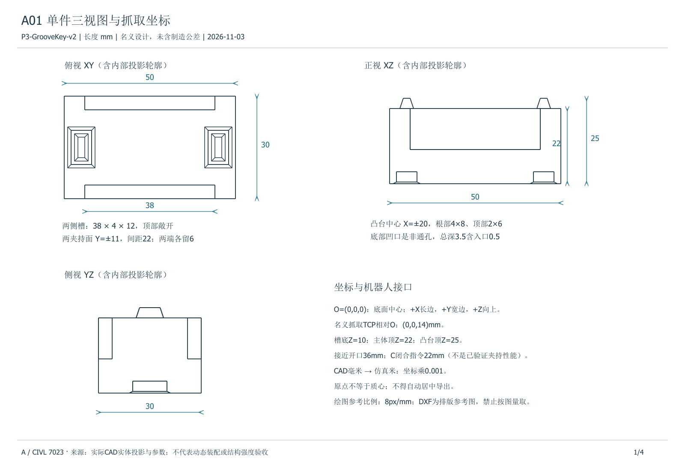
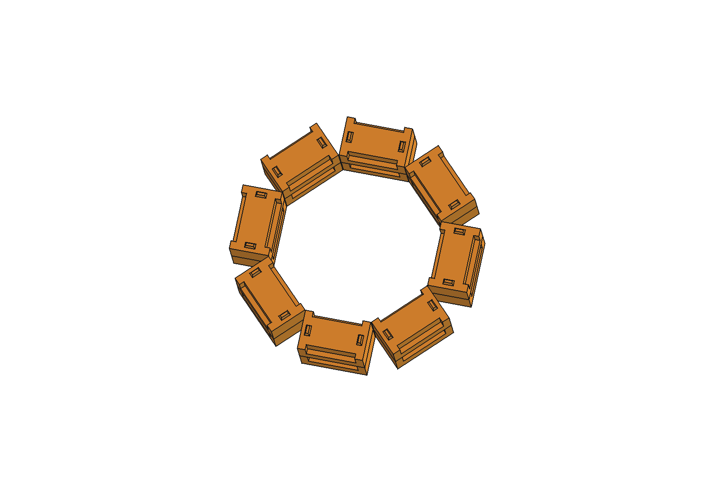

# 两层 16 件八边形结构设计

设计交付版 A-R02，2026-11-09。用于固定基座 PiPER 的逐件抓放与分层装配演示。设计采用 8 组上下叠放的 P3-GrooveKey-v2 构件。原六件直墙属于第一阶段的预验证布局。当前主方案和 B、C 的装配运行均采用两层八边形。

## 单件、夹持与定位

| 项目 | 名义值或定义 |
| --- | --- |
| 构件几何坐标 | 底面中心为原点，+X 沿长度，+Y 沿宽度，+Z 向上 |
| 主体和总包络 | 主体 50 × 30 × 22 mm，含凸台总高 25 mm |
| 夹持槽 | 两侧各 38 × 4 × 12 mm。X 从 −19 到 +19 mm，Z 从 10 到 22 mm，向上敞开 |
| 夹持面 | Y = ±11 mm，名义夹持面间距 22 mm。几何夹持中心在底面上方 14 mm |
| 双定位凸台 | 中心在 (±20, 0) mm，根部 4 × 8 mm，顶部 2 × 6 mm，高 3 mm |
| 双底部凹口 | 入口 8 × 12 mm，0.5 mm 深处缩至 6 × 10 mm，总深 3.5 mm |
| 凹口名义间隙 | 根部对凹口直壁单侧 1 mm，凸台顶余量 0.5 mm |

主体承压面设在 Z = 22 mm，所以第二层底面 Z = 22 mm，最终最高点 Z = 47 mm。槽口上方敞开给夹指竖向进退留空间。两个分开的凸台可约束就位后的平面窜动和偏转，间隙允许有限游隙。上下无抗拔锁止，同层无连接件。剖面与稳定性计算见[连接与稳定性](连接转角与基本稳定性.md)。

## 目标布局与顺序

机器人世界系中，八边形中心为 (260, 30) mm，构件中心线半径 76 mm，扇区按 +X 起逆时针每隔 45° 编号。构件长轴沿切线摆放，具体偏航方向由取放目标表给定。每层放置顺序为扇区 0、1、7、2、6、3、5、4。先放 1–8 号下层，再放 9–16 号上层。上层 i + 8 号由下层 i 号支承。表中坐标均为构件底面中心。

| 扇区 | 下层件号 | 上层件号 | 世界 X (mm) | 世界 Y (mm) | 偏航 (°) |
| --- | ---: | ---: | ---: | ---: | ---: |
| 0 | 1 | 9 | 336.000 | 30.000 | −90 |
| 1 | 2 | 10 | 313.740 | 83.740 | −45 |
| 7 | 3 | 11 | 313.740 | −23.740 | +45 |
| 2 | 4 | 12 | 260.000 | 106.000 | 0 |
| 6 | 5 | 13 | 260.000 | −46.000 | 0 |
| 3 | 6 | 14 | 206.260 | 83.740 | +45 |
| 5 | 7 | 15 | 206.260 | −23.740 | −45 |
| 4 | 8 | 16 | 184.000 | 30.000 | −90 |

完整 CAD 包络为 182 × 182 × 47 mm，世界坐标范围 X = 169–351 mm，Y = −61–121 mm，Z = 0–47 mm。[16 件初始与目标位姿 CSV](数据/16件初始与目标位姿.csv)保存每件料盘初始位置、最终位置、偏航和 XYZW 四元数，位置用 m，角度提供 rad 和 °。程序以完整精度 CSV 为准。CAD 使用 mm。

工具 TCP 相对 gripper_base 的偏移是 [0, 0, 0.1358] m。取放时工具朝下并跟随构件偏航。几何夹持中心与运行中的 TCP 指令分别定义。具体接近、下降、抬升、转运、下放、退回端点见[运行 TCP 目标](数据/96段TCP端点_B与C.json)，其中包含各自控制实际使用的安全高度与补偿。C 的补偿作用于运行指令，名义构件目标采用同一份 CSV。

## CAD 发版和核对

[八边形 DWG](CAD/octagon_AutoCAD2027.dwg)及同目录 STEP、FCStd、STL 属于 A-R02 的几何基线。B 与 C 的对应模型文件逐字节一致。重新读取单件与总装 STEP 后，按目标表旋转、平移单件，与总装 16 个实体逐件做体积匹配。16/16 匹配，件间正体积交叠为零。同层转角名义最小间距约 0.4934 mm。该值供联调定位，实际装配间隙由零件偏差、释放位姿和接触共同决定。

原生 DWG 和[带尺寸标注 DWG](CAD/octagon_dimensioned.dwg)均在 AutoCAD 2027 核心控制台复开，识别到 16 个三维实体、毫米单位，AUDIT 发现 0 项错误。带标注版保留 8 条文字尺寸说明。 [尺寸图预览](图表/A_八边形尺寸标注.png)

附 [CAD 核对数据](证据/CAD与目标静态核对.json)和[质量惯量参数](数据/质量惯量_候选参数.json)。JSON 内部的原始文件路径沿用源工程命名，本回传的 CAD 入口为上面的链接。
