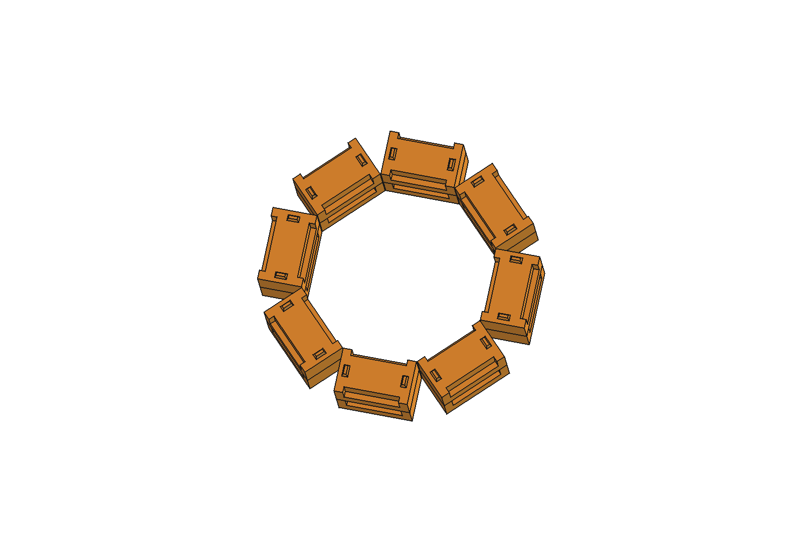
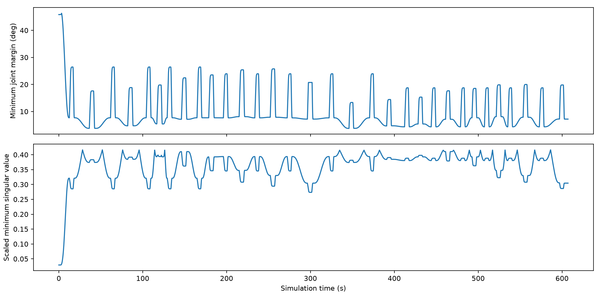
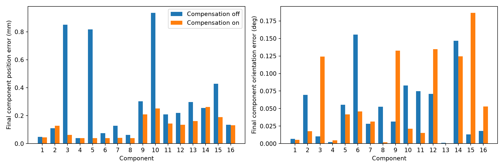
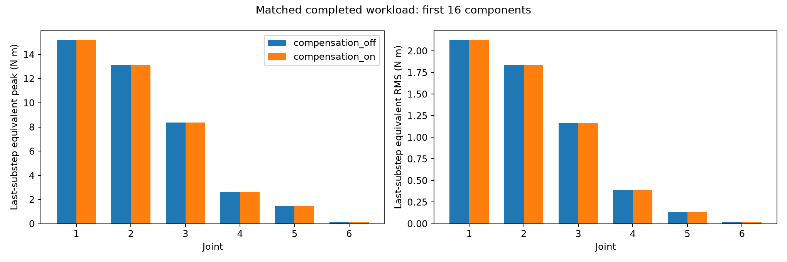
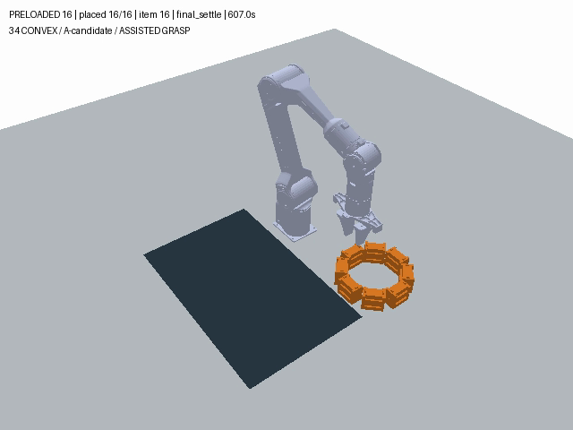

# CIVL7023 Project 3 第三阶段完整报告初稿

**烧结模拟月壤构件的设计与机器人装配**

2026 年 11 月 13 日 · A、B、C 章节整合

## 摘要

本研究设计槽榫构件，并在月面重力仿真中使用 PiPER 六轴机械臂完成两层 16 件八边形装配。第三阶段冻结 V2 几何、目标位姿和候选载荷，在同一台机器上分别关闭和开启抓取偏置补偿。两个工况均从零完成 16 件及 96 个运动目标，定义外碰撞记录均为 0。开启补偿后，最大最终位置误差从 0.935791 mm 降到 0.261732 mm，最大姿态误差从 0.155598° 增至 0.186519°，J6 全程等效力矩 RMS 增加 2.271%。当前演示以定位为优先，选用补偿开启工况。结论适用于候选材料、理想仿真位姿、辅助抓持与离散碰撞检查条件。

## 1 结构设计与材料

研究目标是验证小型月面构件的机器人可抓取性、可装配性与月面重力下的基本关节力矩。单件 P3-GrooveKey-v2 的主体为 50 × 30 × 22 mm，含顶部凸台总高 25 mm。底面中心为构件几何原点。局部 X 沿长边，Y 沿宽边，Z 向上。两侧各设 38 × 4 × 12 mm 向上开口的槽，夹持面间距 22 mm。双凸台在底部凹口内提供分层定位，直壁单侧名义间隙 1 mm，凸台顶部余量 0.5 mm。上层由下层主体顶面支承，层距 22 mm。

八边形中心在世界系 (260, 30) mm，构件中心线半径 76 mm。每层按扇区 0、1、7、2、6、3、5、4 依次装配。件号 1–8 放在 Z = 0 mm，9–16 放在 Z = 22 mm。总装包络 182 × 182 × 47 mm。同层转角名义最小间距 0.4934 mm，八组上下件无同层连接。16 个 STEP 实体逐件与目标位姿匹配。底面目标表保留世界坐标 m、角度 rad 与 XYZW 四元数。

*图 1　两层 16 件八边形 CAD 总装。*

材料采用均匀刚体的仿真近似。候选有效密度 2,500 kg/m³ 参考烧结 EAC-1A 研究 (Ginés-Palomares et al., 2023)，正式材料采用待 A 确认。CAD 单件体积为 29,042.6667 mm³，质量为 72.6067 g。质心位于底面原点上方 10.5663 mm，质心主惯量为 diag(7.55472 × 10⁻⁶, 1.87063 × 10⁻⁵, 2.04034 × 10⁻⁵) kg·m²。月面重力 1.62 m/s² 下，层间 1,004 mm² 平面的理想平均承压为 117.15 Pa，同组两件在 1,308 mm² 底面上的理想平均承压为 179.85 Pa。

<!-- page -->

## 2 PiPER 运动学与控制

六个转动关节由 PiPER URDF 中的名称 joint1 至 joint6 映射。正运动学沿 URDF 关节链组合固定变换和关节转动，再施加夹爪基座系下的 TCP 偏移 [0, 0, 0.1358] m。仿真构件的底面原点由惯性系位置减去旋转后的质心偏移恢复。解析雅可比的第 i 列由世界系关节轴与 TCP 杠杆臂的叉乘、以及该关节轴组成。姿态残差采用最短轴角。以 0.3 m 为特征长度缩放雅可比，避免平移与转动的数值量纲直接混合。

逆解采用多初值加权阻尼最小二乘法。迭代阻尼为 0.015，求解角投影到距 URDF 限位至少 2° 的区间，独立 FK 残差门槛为位置 10 µm、姿态 10⁻⁴ rad。外环执行用 60 Hz DLS，任务误差增益 3、阻尼 0.02，线速度与角速度限幅分别为 0.04 m/s 和 0.3 rad/s，关节率缩放上限 0.35 rad/s。位置电机内环采用 positionGain = 0.15、velocityGain = 1.0，命令最大速度按 0.6 rad/s 与 URDF 速度上限取小。目标连续 15 个控制样本满足位置误差 < 0.1 mm、姿态误差 < 0.1°、关节速度 < 0.02 rad/s 后记为到达。关节限位、雅可比与控制结果来自 B 的技术章节及运行证据。

## 3 仿真规划与装配流程

固定基座 PiPER、地面、料盘和 16 个预置动态构件组成 19 个物体。构件使用 34 个凸碰撞子形状。每件依次接近、下降、闭爪、抬升、转运、下放、释放、退回及沉降。每段更新其他 15 件的位姿并纳入障碍。非竖直段优先尝试直连，以 5 mrad 关节边采样检查并对五次过渡命令网格预检。竖直段使用 2 mm 位置采样与 1 mrad 关节边检查，执行时再用 DLS 与在线守卫。项目支持直连受阻时尝试 RRT-Connect。

闭爪时，两侧夹指在指定槽区出现正法向接触后，按实际相对位姿建立固定辅助约束。释放时先张开至 36 mm，连续 5 个间隔 50 ms 的样本满足开口 > 35.5 mm、手指无有效接触、构件线速度 < 2 mm/s、角速度 < 0.02 rad/s，才解除约束。落位验收采用位置 < 3 mm、姿态 < 0.05 rad、线速度 < 5 mm/s 且有下方支撑。运动和物理检查覆盖机械臂、地面、夹爪、持件、库存件与已放置件。既定的夹持和支撑接触按阶段及容差处理。

抬升后读取仿真的 TCP 位姿和构件底面原点，将抓持偏置变换到 TCP 局部系，再按目标工具朝向转回世界系，用负水平偏置修正转运和下放的 TCP 指令。退回沿用名义 XY。修正量超过 2 mm 时程序报错。物体名义目标依然对应冻结 CAD。该算法以仿真精确状态为输入，直接校正的量是指令 XY。

*图 2　开启补偿工况的关节限位裕度与缩放雅可比最小奇异值。*

<!-- page -->

## 4 正式实验方案和结果

2026 年 11 月 10 日在同一 macOS ARM64 环境、同一冻结代码及相同初始库存下，两组各从零运行一次。实验开关为抓取偏置补偿。两组采用相同 PiPER、V2 模型、候选载荷、碰撞和释放门槛。外部时间步为 1/240 s，每步 4 个子步。构件质量和惯量经实际加载记录复核，PiPER 的实际导入张量由 Bullet 导入方式决定并逐杆记录。每组逐件核对最终底面原点、名义目标及下方支撑。

**表 1　同机正式对照结果**

| 指标 | 关闭补偿 | 开启补偿 |
| --- | ---: | ---: |
| 完成构件及到达运动目标 | 16/16 · 96/96 | 16/16 · 96/96 |
| 释放门控通过 | 16/16 | 16/16 |
| 直连命令网格预检段 | 64 | 64 |
| 竖直采样 IK 和在线守卫段 | 32 | 32 |
| RRT 尝试和执行段 | 0 | 0 |
| 定义外碰撞记录 | 0 | 0 |
| 仿真时长 (s) | 606.9833 | 607.1333 |
| 最终位置最大误差 (mm) | 0.935791 | 0.261732 |
| 最终位置 RMS 误差 (mm) | 0.422179 | 0.142215 |
| 最终姿态最大误差 (°) | 0.155598 | 0.186519 |
| 最终姿态 RMS 误差 (°) | 0.069075 | 0.082937 |
| TCP 运动终点最大位置误差 (mm) | 0.047565 | 0.047560 |
| 命令 FK 跟踪位置 RMS (mm) | 0.057412 | 0.057415 |
| 全程最小关节限位裕度 (°) | 3.777857 | 3.753456 |
| 全程最小缩放奇异值 | 0.029388 | 0.029388 |
| 240 Hz 日志采样数 | 145,676 | 145,712 |

最终构件误差以全部装配结束并沉降后的底面几何位姿计算，RMS 跨 16 件。TCP 终点误差在每段收敛时计算。命令跟踪以 FK(q_command) 和同一控制采样的实际 TCP 比较。运动途中到最终目标的距离含正常搬运过程，属于另一种记录量。两组 96 个名义和 96 个实际运动目标均有运动学核对。全程离散碰撞结果按对象、阶段和容差解释。

<!-- page -->

## 5 目标落位与设计取舍

关闭组最大位置误差出现在第 10 件，开启组出现在第 14 件。最大姿态误差对应第 6 件和第 15 件。开启后，最大位置误差下降 72.031%，位置 RMS 下降 66.314%，最大姿态误差上升 19.872%，姿态 RMS 上升 20.068%。补偿组最大 XY 修正量为 0.825833 mm，发生在第 6 件。TCP 终点和命令 FK 跟踪表现接近，仿真时长增加 0.15 s。

*图 3　B 的同机正式对照中，两组最终构件位置与姿态误差。*

第二阶段 C 的 Windows 运行 full01 在第 10 件下放前预测与第 9 件穿透约 0.158 mm，完成 9 件。随后 full02_compensated 从零完成 16 件，最大最终误差为 0.350763 mm 和 0.586786°。这两次运行构成历史复现案例。其诊断扫描的两个工况高度相差约 21.609 mm。第三阶段有关补偿取舍的依据为表 1 的同机对照。

结构定版沿用已完成两组正式运行的 V2 接口和 16 件排布。转角留缝允许独立摆放，但对实际水平抓持偏置敏感。当前方案的修改集中在补偿后的指令和冻结文件。后续若改变构件、接口、材料或布局，应更新对应 CAD、目标表和仿真参数，再复测受影响工况。

<!-- page -->

## 6 月面重力下的关节力矩

POSITION_CONTROL 的关节电机反馈每外部步保存一次。当前构建的六组校准支持将 4 子步配置下的原始电机反馈乘 4，得到最后子步等效力矩。表 2 使用全程 240 Hz 样本计算峰值与 RMS，含初始化和最终沉降。传感器反力和辅助约束反馈另行记录。PiPER 加载采用现有 Bullet 导入方式。以下绝对力矩适用于所记录的导入参数和辅助抓持模型。

**表 2　全程最后子步等效电机力矩**

| 轴 | 关闭峰值 (N·m) | 开启峰值 (N·m) | 关闭 RMS (N·m) | 开启 RMS (N·m) |
| --- | ---: | ---: | ---: | ---: |
| J1 | 15.197513 | 15.196364 | 2.126068 | 2.126062 |
| J2 | 13.132434 | 13.133411 | 1.840181 | 1.840422 |
| J3 | 8.377653 | 8.378968 | 1.167543 | 1.167391 |
| J4 | 2.586912 | 2.586184 | 0.391378 | 0.391395 |
| J5 | 1.462172 | 1.462203 | 0.133565 | 0.133476 |
| J6 | 0.100224 | 0.100224 | 0.017523 | 0.017921 |

*图 4　两组完整 16 件任务的等效峰值和 RMS，含初始化和最终沉降。*

两组的全轴最高等效峰值均出现在第 11 件转运的 J1，约 15.2 N·m。开启组 J3 等效峰值增加约 0.001315 N·m，J6 RMS 增加 0.000398 N·m。原始反馈、最后子步等效量及去除初始化和最终沉降的共同阶段统计详见 B 原始表。当前外步采样只记录 960 Hz 内部步序列中的部分样本。

<!-- page -->

## 7 结论与适用范围

在冻结的 16 件八边形、候选材料与仿真条件下，两组均完成全部装配。以定位为优先时，采用开启补偿的方案可获得本轮较小的最终位置误差，同时承担姿态误差、部分轴力矩和仿真时长的增加。每工况一次运行，统计可靠性、真实测量噪声下的表现和硬件适用性仍待验证。

结构验算针对名义平地自重支承。制造公差、连接承载、整体抗倾覆、气密及实物摩擦抓取需另行验证。补偿依赖精确仿真位姿，抓取采用辅助固定约束。碰撞检查使用离散采样，阶段允许的夹持和支撑接触保留。最终演示采用开启工况时，应使用同次运行的 3,036 帧原速视频及对应结果。第四阶段需由组员复核报告、CAD、仿真与视频的一致性，并交叉复现代表性工况。

*图 5　B 的 11 月 10 日开启补偿工况末帧。*

## 参考依据

1. HKU CIVL7023. (2026). *Project 3 requirements and robot assembly teaching materials* [课程资料]。

2. Ginés-Palomares, J.-C., Fateri, M., Schubert, T., de Peindray d’Ambelle, L., Simon, S., Gluth, G. J. G., Günster, J., & Zocca, A. (2023). Material aspects of sintering of EAC-1A lunar regolith simulant. *Scientific Reports, 13*, 23053. [DOI](https://doi.org/10.1038/s41598-023-50391-y)

3. Part A. (2026, November 9). *两层 16 件八边形结构设计及材料候选说明* [组内设计与 CAD]。见仓库 AC回传/A。

4. Part B. (2026, November 10). *PiPER 运动学控制与月面装配评价* [技术章节、两组正式运行及独立复核]。见仓库 B_第三阶段报告及 B_第三阶段_2026-11-10。

5. Part C. (2026, November 7). *仿真规划与装配及跨机复现记录* [第二阶段运行记录]。见仓库 AC回传/C 及 runs/C_stage2。

工程及证据版本见 [小组仓库冻结快照](https://github.com/yhdhhhhuk/hku-civl7023-project3/tree/f2e8f2cb396332e94656cf3baaba3c4d80c8ac7e)。
