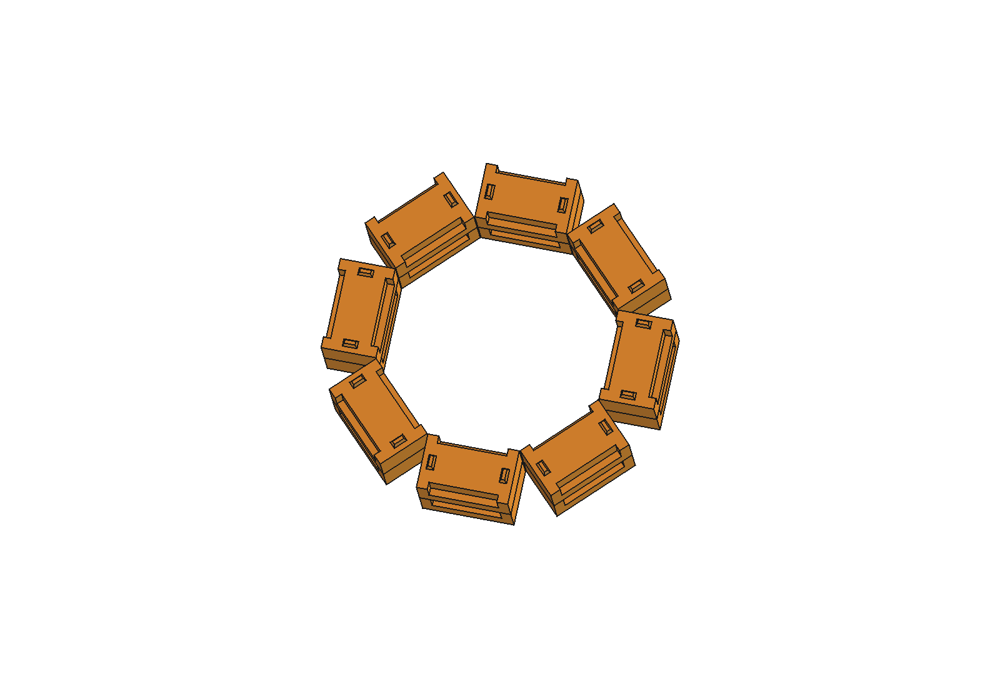
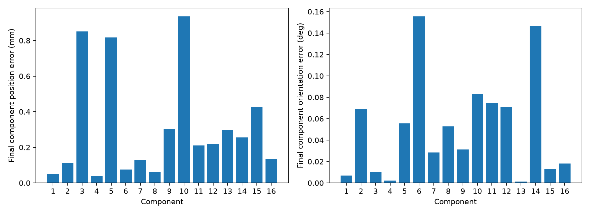
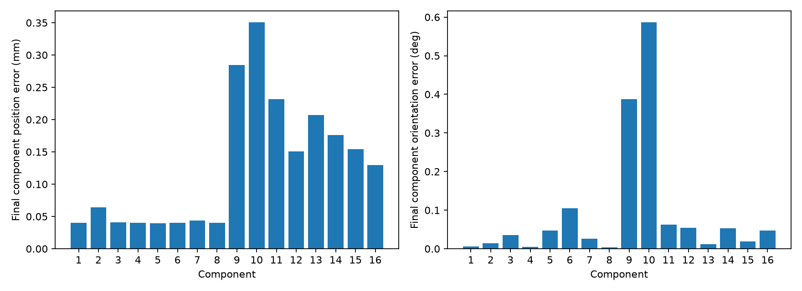
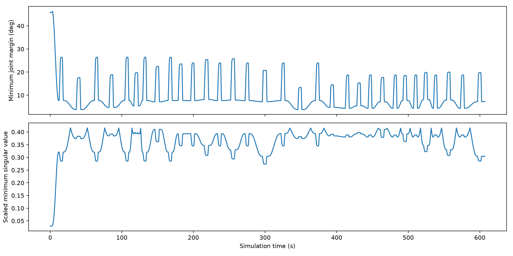
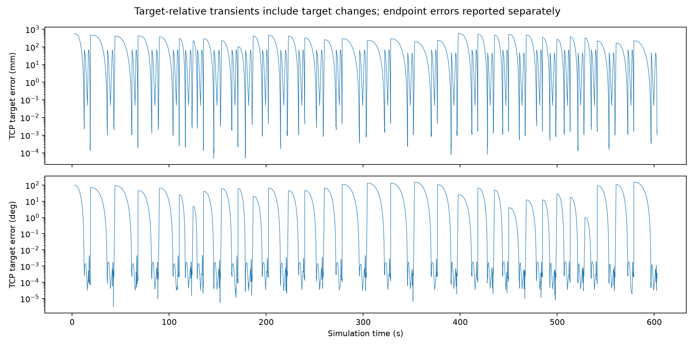
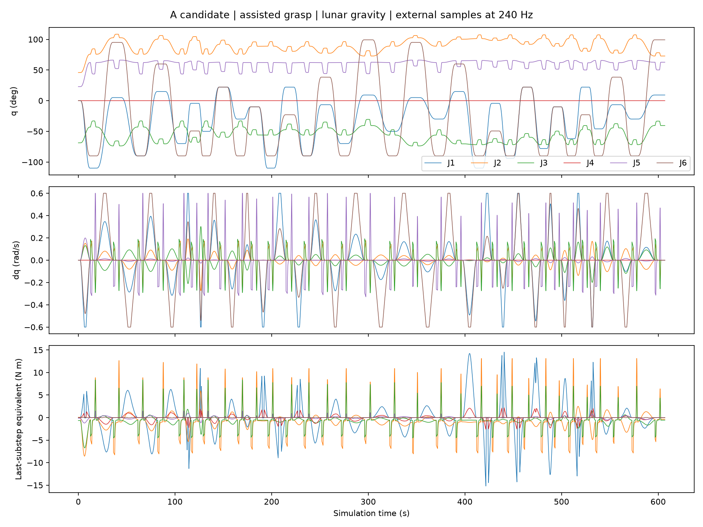

# CIVL7023 Project 3 第二阶段报告初稿

**烧结模拟月壤构件的设计与机器人装配**

2026-11-09｜A、B、C 方法与结果整合稿｜设计版 A-R02｜候选材料工况 A-candidate

## 摘要

本项目设计可供 PiPER 六轴机械臂逐件抓放的槽榫构件，并将 16 件组成两层八边形。A 根据已验证布局更新设计、目标和支承说明。B 在候选载荷下从零完成 16 件，C 在 Windows 首轮遇到下放碰撞预检阻塞，随后使用仿真位姿补偿抓取偏置并从零完成 16 件。两次成功运行分别完成 96 个运动段，定义外碰撞记录均为 0。最终构件位置误差最大值分别为 0.9358 mm 和 0.3508 mm，姿态误差最大值分别为 0.1556° 和 0.5868°。结论适用于该模拟材料、辅助抓取、指定支承和离散检查条件下的装配演示。

## 1. 结构设计与材料

单件 P3-GrooveKey-v2 主体尺寸 50 × 30 × 22 mm，含凸台总高 25 mm。构件坐标原点在底面中心，X 沿长边，Y 沿宽边，Z 向上。两侧 38 × 4 × 12 mm 槽开口朝上，夹持面为局部 Y = ±11 mm，名义间距 22 mm。两个凸台与底部凹口形成上下层定位，单侧名义间隙 1 mm、顶余量 0.5 mm。承压发生在主体顶面，层距为 22 mm。

八边形环中心在世界系 (260, 30) mm，构件中心线半径 76 mm，长轴切向排列。两层底面分别为 Z = 0 和 22 mm。每层按扇区 0、1、7、2、6、3、5、4 装配，件号 1–8 为下层、9–16 为上层。总装包络 182 × 182 × 47 mm。重新读取总装 STEP 后，按完整目标表逐件匹配 16 个实体，正体积重叠为零。初始和目标物体位姿使用 m、rad 和 XYZW。运行 TCP 端点单独记录。 [16件设计说明](16件八边形结构设计说明.md) · [初始与目标表](数据/16件初始与目标位姿.csv)

*图 1. 两层 16 件八边形总装。*

仿真沿用 2,500 kg/m³ 的均匀有效密度。按单件 CAD 体积 29,042.6667 mm³ 得质量 72.6067 g。底面原点上方质心高 10.5663 mm。质心惯量沿几何 XYZ 轴为 diag(7.55472 × 10⁻⁶, 1.87063 × 10⁻⁵, 2.04034 × 10⁻⁵) kg·m²。B、C 的动力学载入记录与完整精度输入一致。密度是文献参考的建模假设，采用状态单列。 [材料假设与签核](材料假设确认.md)

各转角同层名义最小间距 0.4934 mm。本阶段将有缝且无侧连接的排布用于分层装配演示。上下定位接口为松配合，允许沿竖向脱开。月面重力 1.62 m/s² 下，每件重约 0.117623 N。上层通过约 1,004 mm² 平面接触面积传给下层，理想平均压力为 117.15 Pa。每组两件通过下层 1,308 mm² 的底面传到地面，理想平均压力为 179.85 Pa。居中质心投影位于支承凸包内。该计算适用于名义平地、自重和刚体条件。 [支承与转角计算](连接转角与基本稳定性.md)

## 2. 运动学与控制

PiPER 的六个转动关节按 URDF 名称映射，TCP 相对 gripper_base 的偏移为 [0, 0, 0.1358] m。正运动学沿关节树累乘刚体变换。世界系几何雅可比的平移列由关节轴与 TCP 杠杆臂的叉乘给出，旋转列为对应关节轴。姿态残差用轴角表示。逆运动学采用多初值和限位投影的加权阻尼最小二乘。雅可比用 0.3 m 特征长度缩放，奇异值及条件数在该尺度下解释。

外部仿真步为 240 Hz，每步 4 个内部子步，控制周期为 60 Hz。B 的笛卡尔反馈对位置和轴角残差采用增益 3、阻尼 0.02，速度限制分别为 0.04 m/s 和 0.3 rad/s。非竖直段用关节路线和五次过渡，竖直段用分段 IK 与带守卫的 DLS。B 的目标收敛要求连续 15 个控制样本满足 TCP 位置误差 < 0.1 mm、姿态误差 < 0.1°、关节速度 < 0.02 rad/s。末端误差按运动目标统计，落位误差按释放并沉降后的构件底面几何位姿统计。 [B 方法原稿](证据/B/B_运动学控制与力矩章节初稿.md)

## 3. 仿真、规划与连续装配

16 件在物理步 0 前预置在共面料盘，地面提供物理支撑。场景物体数为 19，构件采用 34 个凸碰撞子形状。每件依次接近、下降、闭爪、抬升、转运、下放、释放、退回和等待稳定。每次运动更新场景，将其余 15 件纳入障碍，检查机械臂自碰撞、地面、夹爪、带载构件及其他构件。非竖直段先尝试关节直连，必要时可使用 RRT-Connect，并检查五次时间轨迹的命令采样网格。竖直段按 2 mm 笛卡尔位置采样、1 mrad 关节边采样，再做带守卫的闭环执行。C 成功运行的实际方法为 64 段直连和 32 段竖直。

闭爪时要求双指在指定槽区域产生有效接触，再建立固定辅助约束。释放门控要求开口 > 35.5 mm、手指无有效接触、线速度 < 2 mm/s、角速度 < 0.02 rad/s，并连续 5 个 50 ms 样本满足条件。解除约束后构件在仿真中动态沉降，完成判据包括落位精度、静止程度及下方支承。碰撞记录按阶段、对象、容差和采样规则解释，允许预定义的夹持及支承接触。 [C 方法原稿](证据/C/C_仿真规划与装配章节.md)

## 4. 结果、失败与修复

| 项目 | B 候选从零 16 件 | C full02_compensated |
| --- | ---: | ---: |
| 完成构件数 | 16/16 | 16/16 |
| 到达运动段 | 96/96 | 96/96 |
| 释放门控 | 16/16 | 16/16 |
| 定义外碰撞记录 | 0 | 0 |
| 仿真时间 (s) | 606.9833 | 607.1833 |
| 最终构件最大位置误差 (mm) | 0.935791 | 0.350763 |
| 最终构件最大姿态误差 (°) | 0.155598 | 0.586786 |
| 运动端点最大 TCP 位置误差 (mm) | 0.047565 | 0.047566 |
| 全程最小关节限位裕度 (°) | 3.77786 | 3.77786 |
| 全程最小缩放奇异值 | 0.029388 | 0.029388 |
| 240 Hz 外步采样数 | 145,676 | 145,724 |
| 同次物理渲染视频帧数，5 fps | 3,035 | 3,036 |

B 的运行用固定名义偏置。C 的首轮 full01 在第 10 件下放前预测与第 9 件发生约 0.158 mm 穿透并停止，成功件数为 9。C 用抬升后仿真精确位姿求取实际构件原点在 TCP 系内的偏置，并修正转运和下放的 XY 指令，补偿上限 2 mm。构件名义位姿、物理参数与碰撞判据采用与原运行相同的输入。C 修复版从零完成 16 件。表内误差差异同时受补偿和运行环境影响。第 10 件案例和完整结果分别引用各自记录。 [B 复核](证据/B/验收结论与AC对接清单.md) · [C 复现](证据/C/跨机复现记录.md)

*图 2. B 的候选载荷完整运行中，各件最终落位误差。*

*图 3. C 的补偿版运行中，各件最终落位误差。两图来自不同运行。*

*图 4. B 运行中的限位与缩放雅可比指标。*

*图 5. B 运行的 TCP 误差，独立于构件沉降后误差。*

## 5. 月面驱动力矩

B、C 均以 240 Hz 记录六轴电机反馈。各自用 6 组单关节校准，支持当前 4 子步配置下用原始 motor 反馈乘 4 得到最后子步等效值。下表峰值取绝对值，RMS 基于全程外步采样。关节传感器反力和辅助约束反馈另列。等效力矩反映仿真内环、机器人自重、运动和接触的共同作用。完整 960 Hz 内部子步峰值与实机驱动安全范围需要另外验证。

| 关节 | B 等效峰值 (N·m) | B 等效 RMS (N·m) | C 等效峰值 (N·m) | C 等效 RMS (N·m) |
| --- | ---: | ---: | ---: | ---: |
| J1 | 15.19751 | 2.12607 | 15.22354 | 2.12576 |
| J2 | 13.13243 | 1.84018 | 13.13397 | 1.84015 |
| J3 | 8.37765 | 1.16754 | 8.37771 | 1.16754 |
| J4 | 2.58691 | 0.39138 | 2.59228 | 0.39136 |
| J5 | 1.46217 | 0.13356 | 1.46221 | 0.13346 |
| J6 | 0.10022 | 0.01752 | 0.10022 | 0.01803 |

*图 6. B 的候选载荷运行关节运动和力矩。分阶段统计保留于证据目录。*

## 6. 阶段结论与验证边界

16 件名义布局、支承关系与候选载荷输入已在设计和运行记录之间核对。B 与 C 的成功运行给出同一布局下的数值装配证据。C 首轮阻塞表明，0.4934 mm 的名义转角间距对实际抓取偏置敏感。后续应保留第 10 件作为回归工况，检验加入姿态估计噪声和制造偏差后的可放置范围。整体抗倾覆、连接强度、实物摩擦抓取及接触载荷能力待进一步验证。

## 参考依据

1. CIVL7023 Project 3 Requirements 与课程机器人装配相关讲义，组内课程资料。
2. Ginés-Palomares, J.-C. et al. (2023). *Material aspects of sintering of EAC-1A lunar regolith simulant*. Scientific Reports 13, 23053. [论文](https://doi.org/10.1038/s41598-023-50391-y)
3. B，第二阶段候选载荷运行与独立复核，2026-11-04，载于 2026-11-05 AC 整合包。 [B 证据入口](证据/B/验收结论与AC对接清单.md)
4. C，第二阶段跨机复现与回传，2026-11-07。 [C 证据入口](证据/C/跨机复现记录.md)
