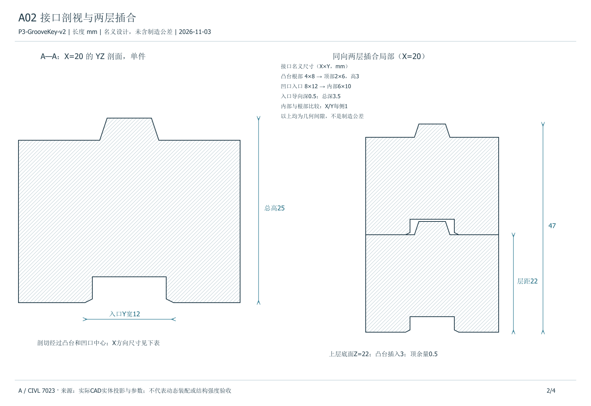

# 连接、转角与基本稳定性

本阶段接受八边形转角留缝，结构用途定位为月面分层机器人装配演示。环由 8 组上下对齐的两件单元构成，缝隙使相邻扇区可以分次竖直放入并给夹爪退回留空间。同层件无侧向互锁，整体可靠性按各组支承及相邻避碰来解释。

## 接口与间隙

上层凹口罩住下层两个凸台。承重路径从上层底面进入下层主体顶面，再从下层底面传到平地。上下为松配合，凸台在相对位移足够大时可能通过侧壁接触传递横向力。凸台顶端名义剩余 0.5 mm，主要竖向承压面是 Z = 22 mm 处的平面。上层沿 +Z 抬起可脱开。

同层邻件的内侧最近角间距为 2[(76 − 15) sin(22.5°) − 25 cos(22.5°)] = 0.4934 mm，使用的是构件底部完整矩形截面的名义尺寸。该结果与 16 对邻件的实体最近距离一致，包含上下两层各 8 个转角。转角缝随测量位置变化。此值只用于描述理想几何，夹取后偏置、角度误差及沉降都影响实际最小间距，不能由最终质心或底面原点误差单独判断。

C 的 full01 在第 10 件下放前预测与第 9 件穿透约 0.158 mm，系统停止下放，保留前 9 件结果。故障快照的几何扫描给出补偿前 −0.161 mm、补偿后 +0.224 mm 的最小间距。C 按抬升后仿真位姿补偿 TCP 的 XY 指令，补偿上限 2 mm。full02_compensated 从零完成 16 件，表明这一控制改动在该运行中解决了装配阻塞。后续若加入制造误差或真实测量噪声，需要重新核对这个转角的可放置性。

## 自重支承

名义几何采用居中落位、平面刚体接触及月面重力 1.62 m/s²。每件质量 0.0726067 kg，自重 0.117623 N。上层与下层平面实体的交集面积为 1,004 mm²。下层底面扣除两处凹口入口后为 1,308 mm²。八组的静态几何面积相同。

| 载荷路径 | 法向力 (N) | 名义承压面积 (mm²) | 平均压力 (Pa) |
| --- | ---: | ---: | ---: |
| 上层单件 → 下层顶面 | 0.117623 | 1,004 | 117.15 |
| 同一组两件 → 地面 | 0.235246 | 1,308 | 179.85 |

名义质心投影在构件底面中心，位于两处接触面的支承凸包内部。理想支承凸包由外角确定，半尺寸为 25 mm、15 mm。单件上层质心高于层间支承面 10.566 mm。上下两件等质量时，整组质心高于地面 21.566 mm。全环总质量约 1.16171 kg，对地总自重约 1.88196 N。这些结果支持名义居中、平地、竖向自重工况下的基本支承。

平均压力随实际接触面积和偏心变化。烧结件强度、摩擦系数、坡面与扰动、抗拔、整体抗倾覆和气密性能仍待实验或专项计算。B、C 的释放后动态沉降和支撑接触属于各自运行条件下的装配证据。
